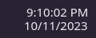

# Paneltime

A compact, Windows-inspired clock for the KDE Plasma panel. Two quiet lines, one clean right edge, and the familiar KDE calendar.

[Русская инструкция](README.ru.md) · [Release checklist](docs/RELEASING.md)



*Rendered preview of the actual clock face at 100% scale; the background comes from your Plasma theme.*

- Time above date, aligned by the visible right edges of the characters.
- Noto Sans Regular, 15 logical pixels, with close line spacing.
- Native KDE calendar, time zones, clipboard menu, and clock settings.
- Optional seconds, 12/24-hour time, and custom date formats.
- Theme-aware colors and panel background. No bundled Microsoft fonts.

## Requirements

Linux with KDE Plasma 6, `kpackagetool6`, and the standard Plasma Workspace clock/calendar components. **Tested on Plasma 6.8.2**, with a 48 px horizontal panel. The metadata declares Plasma 6.6 as the minimum API; 6.6/6.7 are not verified. This widget uses private KDE clock APIs and may need adjustments on other Plasma versions. Plasma 5 is unsupported.

Install **Noto Sans** through your distribution's font manager (for example, the `noto-fonts` package on Arch Linux). Without it, Qt selects a fallback. The default is 15 logical pixels; physical size depends on display scaling, not resolution alone. Custom styling targets horizontal panels with the date below the time; other layouts use KDE's inherited layout.

## Install

Download `paneltime-1.0.0.plasmoid` from this repository's **Releases** page once a release is published. No compilation is needed.

```sh
kpackagetool6 --type Plasma/Applet --install paneltime-1.0.0.plasmoid
```

Or install through the GUI: right-click the panel → Enter Edit Mode → Add Widgets → Get New Widgets → Install Widget From Local File. Select the `.plasmoid` file. Labels vary by language and Plasma version.

Then search for **Paneltime** in Add Widgets and click or drag it onto your panel. Remove your previous clock only after checking the result. Installation does not change your panel automatically. Do not use `sudo`.

## Configure

Right-click the clock → Configure Paneltime.

- Keep **Automatic** font settings for Noto Sans Regular at 15 px. Use **Manual** to choose a different font, weight, or size; manual sizes are in points.
- Set the date position to **Below time** for the intended appearance.
- Enable seconds or choose a 12/24-hour format in Appearance.
- Set a custom date format, for example `MM/dd/yyyy` or `dd.MM.yyyy`.
- Configure calendar plugins and time zones using the standard KDE pages.

Time and date formats follow your locale by default; Paneltime does not force English or US formatting.

## Update / uninstall

```sh
kpackagetool6 --type Plasma/Applet --upgrade paneltime-1.0.0.plasmoid
kpackagetool6 --type Plasma/Applet --remove local.windows11.clock
```

Replace the filename with the release you downloaded. The internal ID remains `local.windows11.clock` for compatibility with the original development version; its visible name is Paneltime.

After updating, Plasma can retain loaded QML. Sign out and back in, or, on systems with the Plasma systemd user service, run:

```sh
systemctl --user restart plasma-plasmashell.service
```

This briefly restarts the desktop shell and panel. Applications remain open.

## Build from source

Python 3 is sufficient for packaging:

```sh
python3 scripts/build.py
kpackagetool6 --type Plasma/Applet --install dist/paneltime-1.0.0.plasmoid
```

`dist/` contains the installable `.plasmoid`, a source ZIP, and `SHA256SUMS`. The `.plasmoid` is a ZIP with `metadata.json` at its root. Fonts are not included. To regenerate the preview, install PySide6 and run `python3 scripts/preview.py`.

## Troubleshooting

- **Missing from Add Widgets:** close and reopen the widget browser; check registration with `kpackagetool6 --type Plasma/Applet --show local.windows11.clock`.
- **Unsupported Widget:** check your Plasma version and the compatibility notes above. Hover over the card for KDE's explanation.
- **Old appearance after an update:** reload the Plasma session as described above.
- **No date:** enable Show date and choose Below time.
- **Font looks different:** check `fc-match "Noto Sans"` and display scaling.
- **Widget fails to load:** include your Plasma/Qt versions and relevant `journalctl --user -b` messages when opening an issue.

## Credits and license

Derived from [KDE Digital Clock](https://github.com/KDE/plasma-workspace/tree/6296a73f4e4a821d5419b5a243b58b1b6cf1f9c4/applets/digital-clock). See [UPSTREAM.md](UPSTREAM.md) for provenance and changes. The project is distributed under [GPL-2.0-or-later](LICENSE); individual upstream files retain their SPDX notices and license choices in [LICENSES](LICENSES). Not affiliated with Microsoft or KDE. Windows is a Microsoft trademark.
