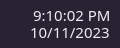

# Paneltime

Компактные часы для панели KDE Plasma, вдохновлённые оформлением Windows: время сверху, дата снизу, общий правый край и стандартный календарь KDE.

[English](README.md)



На изображении — отрисовка настоящего компонента в масштабе 100%. Цвет текста и фон на вашей панели зависят от темы KDE.

## Оформление

Noto Sans Regular, 15 логических пикселей, уменьшенное расстояние между строками. Выравнивание учитывает видимые края букв и цифр. Сохранены календарь KDE, часовые пояса, копирование даты и времени, секунды, формат 12/24 часа и произвольный формат даты.

## Совместимость

Проверено на **Plasma 6.8.2**, горизонтальная панель высотой 48 px. В метаданных указан минимальный API 6.6, но версии 6.6/6.7 не проверены. Используются внутренние компоненты часов KDE, поэтому совместимость с другими версиями не гарантируется. Plasma 5 не поддерживается.

Нужны стандартные компоненты Plasma Workspace, `kpackagetool6` и шрифт **Noto Sans**. Установите шрифт средствами вашего дистрибутива; в Arch Linux пакет называется `noto-fonts`. Без него Qt выберет замену. Размер зависит также от масштаба экрана, а не только от разрешения. Новое оформление предназначено для горизонтальной панели и даты под временем; в других режимах используется унаследованная разметка KDE.

## Установка готового пакета

После публикации релиза скачайте **paneltime-1.0.0.plasmoid** со страницы **Releases** этого репозитория.

```sh
kpackagetool6 --type Plasma/Applet --install paneltime-1.0.0.plasmoid
```

Или через интерфейс KDE: правая кнопка по панели → Режим редактирования → Добавить виджеты → Получить новые виджеты → Установить виджет из локального файла. Выберите `.plasmoid`. Названия пунктов могут отличаться в разных версиях KDE.

В списке виджетов найдите **Paneltime** и добавьте на панель нажатием или перетаскиванием. Старые часы удаляйте после проверки результата. Установка пакета сама по себе не меняет панель. `sudo` не нужен.

## Настройки

Правая кнопка по часам → Настроить Paneltime.

- Автоматический выбор шрифта: Noto Sans Regular, 15 px.
- Ручной выбор: свой шрифт, начертание и размер. Размер в диалоге задаётся в пунктах.
- Для задуманного вида выберите расположение даты **под временем**.
- Секунды и формат 12/24 часа доступны в разделе внешнего вида.
- Для даты можно задать формат `MM/dd/yyyy` или `dd.MM.yyyy`.
- Календарь, дополнительные события и часовые пояса настраиваются стандартными средствами KDE.

По умолчанию форматы даты и времени соответствуют локали системы.

## Обновление

```sh
kpackagetool6 --type Plasma/Applet --upgrade paneltime-1.0.0.plasmoid
```

Подставьте имя нового файла. После обновления Plasma может продолжать показывать старый QML. Выйдите из сеанса и войдите снова либо, если в вашей системе есть служба Plasma для systemd, выполните:

```sh
systemctl --user restart plasma-plasmashell.service
```

Панель и рабочий стол ненадолго перезапустятся, приложения останутся открыты.

## Удаление

```sh
kpackagetool6 --type Plasma/Applet --remove local.windows11.clock
```

Внутренний ID `local.windows11.clock` сохранён для совместимости с ранней версией проекта. Название в интерфейсе — **Paneltime**.

## Сборка из исходников

Нужен только Python 3:

```sh
python3 scripts/build.py
kpackagetool6 --type Plasma/Applet --install dist/paneltime-1.0.0.plasmoid
```

В `dist/` появятся установочный `.plasmoid`, архив исходников и контрольные суммы SHA-256. Шрифты в пакет не входят. Для пересоздания превью нужны PySide6 и команда `python3 scripts/preview.py`.

## Если что-то не работает

- Нет в списке: закройте и откройте список заново. Проверьте установку командой `kpackagetool6 --type Plasma/Applet --show local.windows11.clock`.
- Несовместимый виджет: проверьте версию Plasma и подсказку при наведении на карточку.
- Старый вид после обновления: перезапустите сеанс Plasma, как описано выше.
- Нет даты: включите показ даты и расположение под временем.
- Другой шрифт: проверьте `fc-match "Noto Sans"` и масштаб экрана.

При создании issue укажите версии Plasma и Qt, шаги воспроизведения, скриншот и связанные ошибки из `journalctl --user -b`.

## Лицензия и благодарности

Проект основан на часах KDE Digital Clock. Происхождение исходников и изменения описаны в [UPSTREAM.md](UPSTREAM.md). Лицензия проекта — [GPL-2.0-or-later](LICENSE); уведомления и варианты лицензий исходных файлов KDE сохранены, тексты находятся в [LICENSES](LICENSES). Проект не связан с Microsoft или KDE и не включает шрифты Microsoft.
